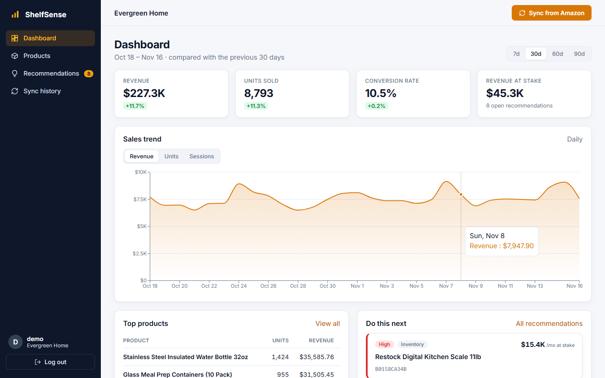
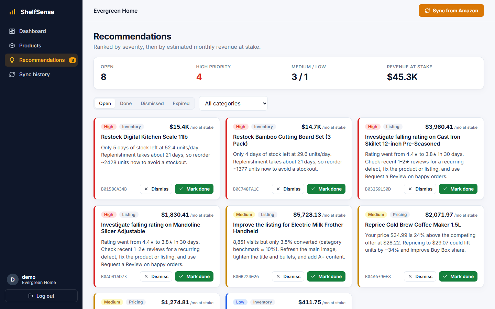
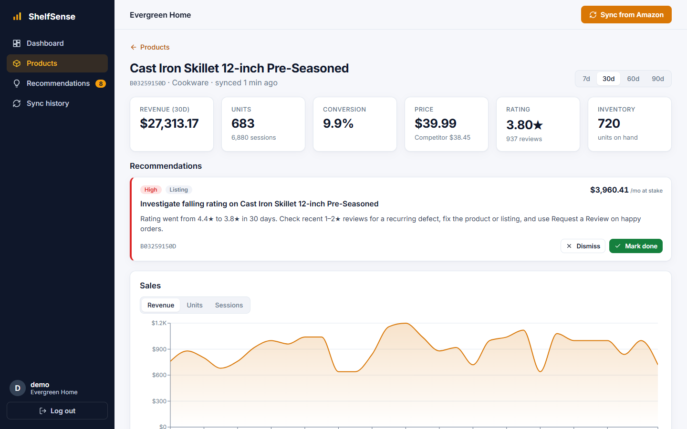
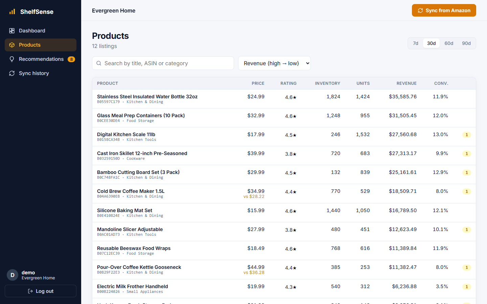
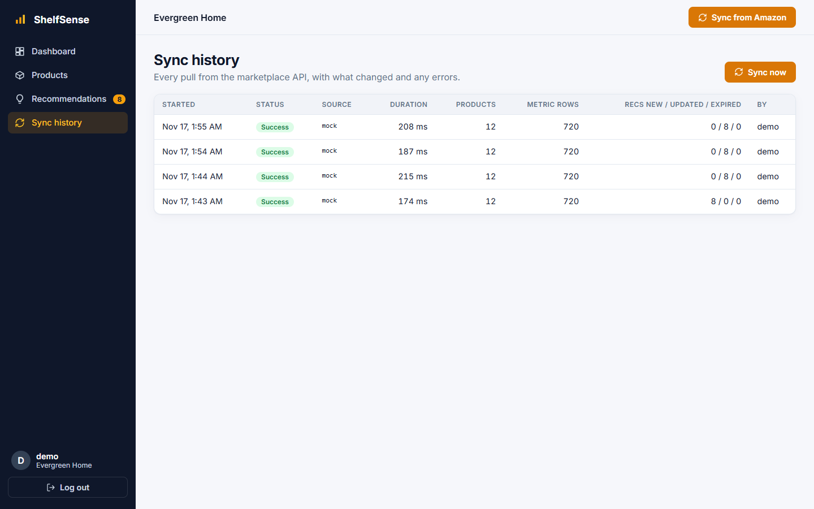
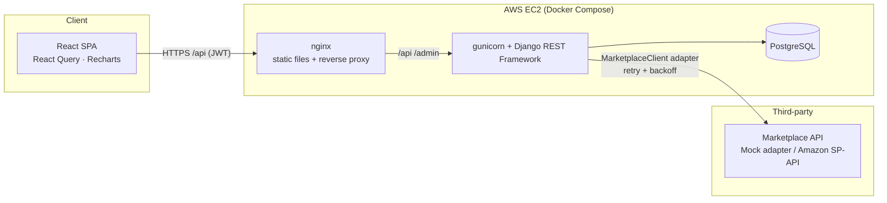

<div align="center">


# ShelfSense

**Amazon sales analytics that tell brands what to do next.**

ShelfSense pulls a brand's Amazon catalog, sales and traffic data, shows how every product is
performing, and turns the numbers into prioritised, explainable recommendations: restock before you
run out, fix pricing that is costing you the Buy Box, catch falling ratings, and improve listings
that get traffic but don't convert.

[](https://github.com/S-Raha23/ShelfSense/actions/workflows/ci.yml)


</div>



---

## Contents

- [Why ShelfSense](#why-shelfsense)
- [Features](#features)
- [Architecture](#architecture)
- [Tech stack](#tech-stack)
- [Getting started](#getting-started)
- [Project structure](#project-structure)
- [Testing](#testing)
- [Documentation](#documentation)
- [Roadmap](#roadmap)

## Why ShelfSense

Amazon gives sellers plenty of reports and very little guidance. A brand manager with 50 ASINs has to
cross-check inventory, competitor prices, reviews and conversion every day to spot the few products
that need attention. ShelfSense does that check automatically after each data sync. It ranks
what needs doing by **severity** and **estimated monthly revenue at stake**, and shows the numbers
behind every recommendation so it can be trusted, not just followed.

## Features

| | |
|---|---|
| **Sales dashboard** | Revenue, units, conversion and sessions for 7/30/60/90 days, with change versus the previous period. Daily or weekly trend chart and top products. |
| **Product analytics** | Per-ASIN sales history, price versus competitor, rating and inventory trends. Server-side search, sorting and pagination. |
| **Recommendation engine** | Five rules across inventory, pricing and listing quality. Each recommendation has a severity, a revenue impact estimate, a plain-English action and the evidence that triggered it. |
| **Recommendation workflow** | Mark done or dismiss, with optimistic UI updates. Dismissed items are snoozed for 14 days, and items whose problem has gone away expire on their own. |
| **Marketplace sync** | One click pulls catalog and 60 days of daily metrics through a pluggable marketplace adapter. Re-runs never duplicate data, failed calls are retried, concurrent syncs are blocked, and every run is logged with counts and errors. |
| **Multi-tenant accounts** | Sign up creates a brand. JWT authentication, and each brand only ever sees its own data. |
| **API docs** | OpenAPI schema with interactive Swagger UI at `/api/docs/`. |

<table>
  <tr>
    <td></td>
    <td></td>
  </tr>
  <tr>
    <td align="center"><sub>Recommendations ranked by severity and revenue at stake</sub></td>
    <td align="center"><sub>Product detail with pricing, rating and inventory trends</sub></td>
  </tr>
  <tr>
    <td></td>
    <td></td>
  </tr>
  <tr>
    <td align="center"><sub>Catalog with search, sorting and period stats</sub></td>
    <td align="center"><sub>Audit log of every marketplace sync</sub></td>
  </tr>
</table>

## Architecture



Inside Django the code is split into four apps with clear jobs:

| App | Job |
|---|---|
| `accounts` | Brands (tenants), user profiles, JWT auth, and the `BrandScopedMixin` that enforces tenant isolation |
| `catalog` | `Product` and the `DailyMetric` fact table, plus read-only dashboard queries (`selectors.py`) |
| `integrations` | The `MarketplaceClient` interface, its mock and SP-API adapters, retry logic, the sync service and `SyncJob` log |
| `recommendations` | The rule framework, five rules, the engine that keeps stored recommendations in step with each sync, and the workflow API |

Key design decisions, each explained in [docs/ARCHITECTURE.md](docs/ARCHITECTURE.md):

- **Adapter pattern for the marketplace.** Business logic depends on an interface, not on Amazon's SDK. Moving from the mock to the real SP-API is a configuration change.
- **Idempotent sync.** PostgreSQL `INSERT … ON CONFLICT DO UPDATE` on natural keys, so syncing twice is safe.
- **Rules are pure functions.** Each one gets a precomputed `ProductContext` and never queries the database, so rules are trivial to unit-test and to add.
- **Aggregation in SQL.** Dashboards use conditional aggregation (`SUM … FILTER`) in a single query, and a regression test guards against join fan-out inflating totals.
- **Tenant isolation in one place.** A mixin scopes every queryset to the user's brand.

## Tech stack

| Layer | Technology |
|---|---|
| Frontend | React 18, React Router, TanStack Query, Axios, Recharts, Vite, hand-written CSS |
| Backend | Python 3.12, Django 5.2, Django REST Framework, SimpleJWT, django-filter, drf-spectacular |
| Database | PostgreSQL 16 |
| Infrastructure | Docker, Docker Compose, nginx, gunicorn, WhiteNoise, AWS EC2 |
| Quality | pytest + pytest-django (25 tests), Vitest, GitHub Actions CI |

## Getting started

### Option 1: Docker (everything in one command)

```bash
git clone https://github.com/S-Raha23/ShelfSense.git
cd ShelfSense
cp .env.example .env
docker compose up --build
```

Open **http://localhost** and log in with the demo account **`demo` / `shelfsense-demo`**, or create
your own brand and press **Sync from Amazon**.

### Option 2: Local development

Requirements: Python 3.12+, Node 20+, PostgreSQL 14+.

```bash
# Database (any Postgres works; this starts one in Docker on port 5434)
docker run -d --name shelfsense-db -p 5434:5432 \
  -e POSTGRES_USER=shelfsense -e POSTGRES_PASSWORD=shelfsense -e POSTGRES_DB=shelfsense \
  postgres:16-alpine

# Backend  ->  http://localhost:8000/api/docs/
cd backend
python -m venv .venv && source .venv/bin/activate   # Windows: .venv\Scripts\activate
pip install -r requirements-dev.txt
export DEBUG=true                                    # Windows PowerShell: $env:DEBUG="true"
python manage.py migrate
python manage.py seed_demo
python manage.py runserver

# Frontend  ->  http://localhost:5173  (proxies /api to Django)
cd ../frontend
npm install
npm run dev
```

All configuration comes from environment variables. See [`.env.example`](.env.example).

## Project structure

```
ShelfSense/
├── backend/
│   ├── config/                 # settings (12-factor), urls, pagination
│   ├── apps/
│   │   ├── accounts/           # Brand, Profile, auth views, tenancy mixin, seed_demo command
│   │   ├── catalog/            # Product, DailyMetric, selectors (read queries), dashboard API
│   │   ├── integrations/
│   │   │   ├── clients/        # MarketplaceClient interface, mock + SP-API adapters
│   │   │   ├── retry.py        # exponential backoff with jitter
│   │   │   └── services.py     # the sync: fetch -> upsert -> regenerate recommendations
│   │   └── recommendations/
│   │       ├── rules/          # inventory.py, pricing.py, listing.py
│   │       └── engine.py       # builds contexts, runs rules, keeps recommendations in step
│   ├── tests/                  # rules, sync, API (incl. tenant isolation)
│   └── Dockerfile
├── frontend/
│   ├── src/
│   │   ├── api/                # axios client (JWT refresh), endpoint functions
│   │   ├── auth/               # AuthContext, ProtectedRoute
│   │   ├── hooks/              # React Query hooks, URL-synced period, debounce
│   │   ├── components/         # Layout, charts, cards, badges
│   │   ├── pages/              # Dashboard, Products, Product detail, Recommendations, Sync
│   │   └── utils/              # formatting (+ tests)
│   ├── nginx.conf              # SPA fallback, asset caching, /api reverse proxy
│   └── Dockerfile              # multi-stage: node build -> nginx
├── docs/                       # architecture, API, engine, deployment
├── docker-compose.yml
└── .github/workflows/ci.yml
```

## Testing

```bash
cd backend && pytest          # 25 tests: rules, sync idempotency, retries, tenant isolation, API
cd frontend && npm test       # formatting utilities
```

CI runs on every push: backend tests against a real PostgreSQL service, a check for missing
migrations, frontend tests and build, and a Docker image build.

## Documentation

| Document | Contents |
|---|---|
| [Architecture](docs/ARCHITECTURE.md) | System design, data model, sync flow, design decisions and trade-offs |
| [Recommendation engine](docs/RECOMMENDATION_ENGINE.md) | Every rule's trigger, severity and impact formula, and how to add a rule |
| [API reference](docs/API.md) | Endpoints, parameters and example responses |
| [Deployment](docs/DEPLOYMENT.md) | Deploying to AWS EC2 with Docker Compose, plus a production upgrade path |
| [Changelog](CHANGELOG.md) | Release history |

## Roadmap

- [ ] Run syncs in a **Celery + Redis** worker on a nightly schedule (needed for SP-API's asynchronous reports)
- [ ] Wire the **SP-API adapter** to live credentials (LWA OAuth, per-operation rate limits)
- [ ] **LLM-generated action plans** for a recommendation, grounded in its evidence
- [ ] Learn rule thresholds per category from which recommendations users act on
- [ ] Multi-marketplace support (amazon.com, .co.uk, .in …) and currency handling
- [ ] Production AWS setup: RDS, S3 + CloudFront for the SPA, Secrets Manager, HTTPS via ALB/ACM

## License

[MIT](LICENSE)
