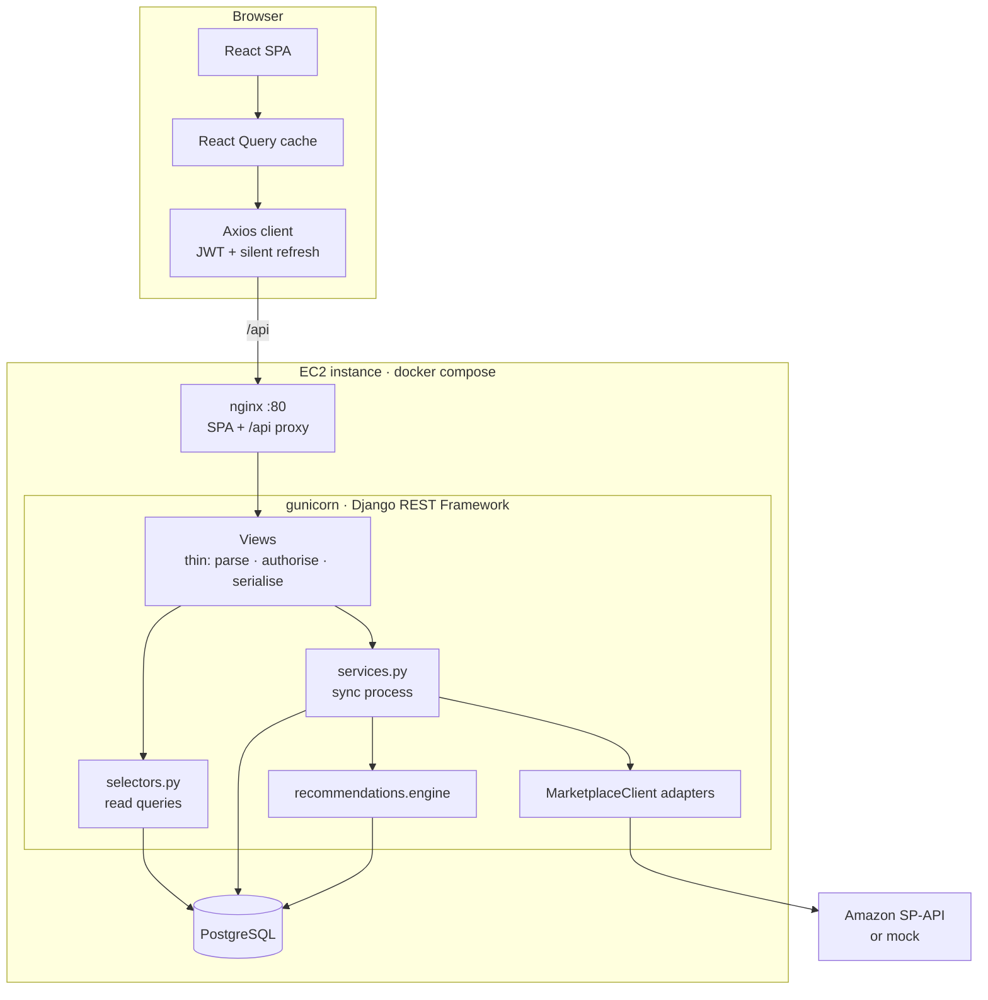
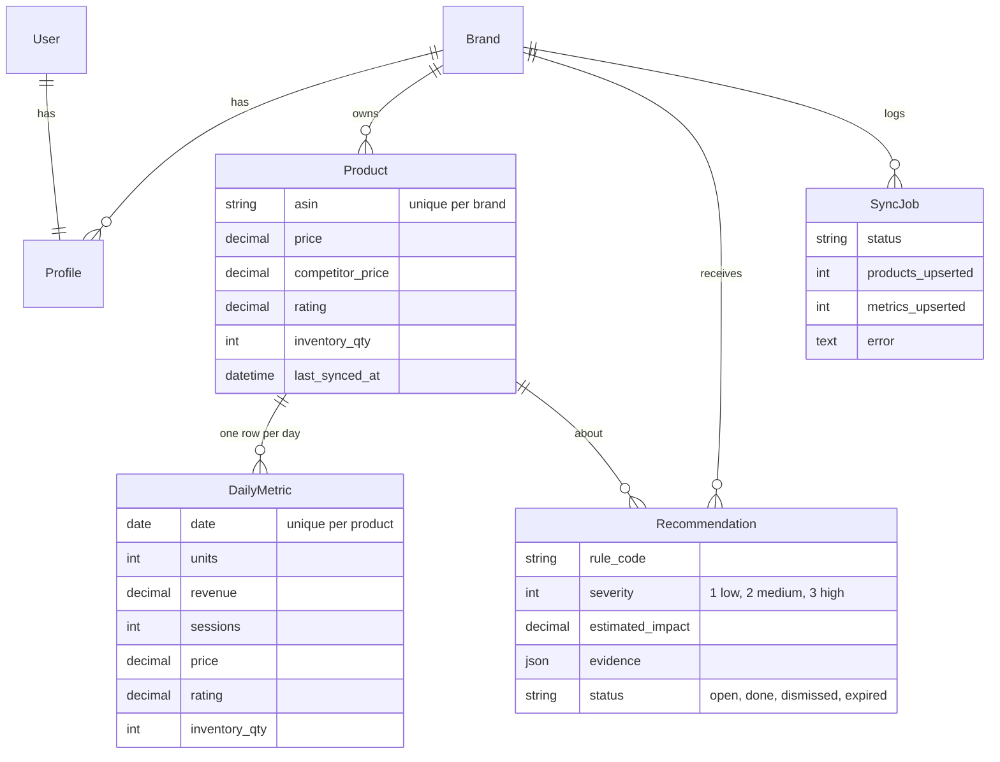
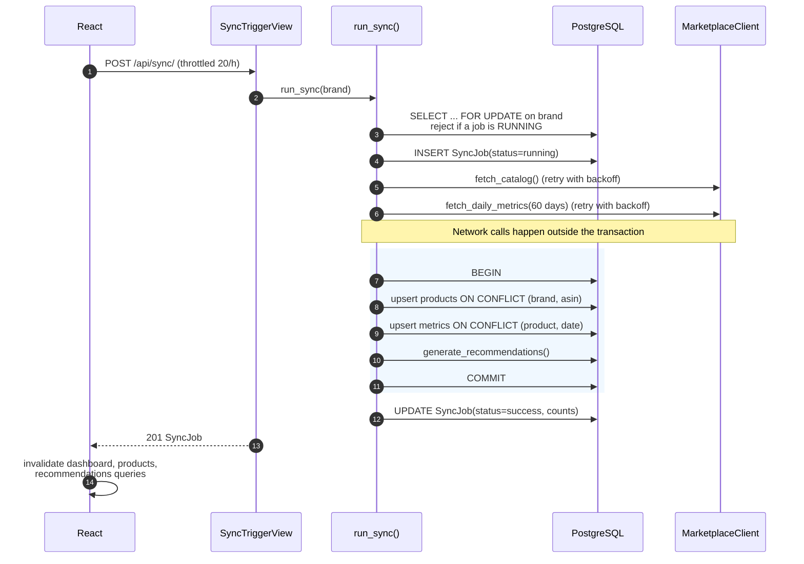
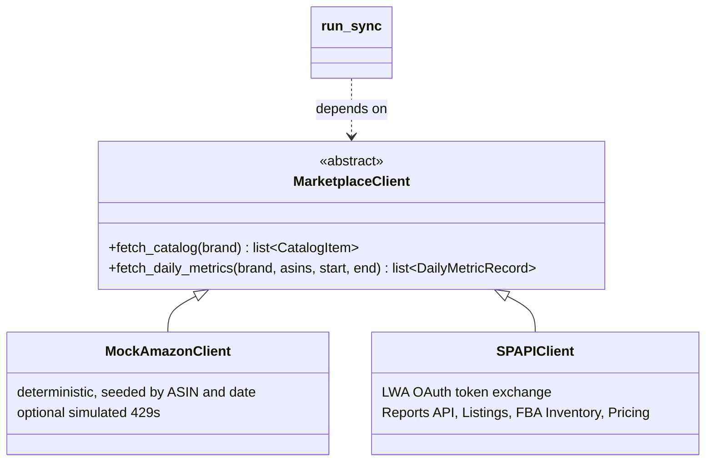

# Architecture

This document explains how ShelfSense is put together and why. For the rules themselves see
[RECOMMENDATION_ENGINE.md](RECOMMENDATION_ENGINE.md).

## 1. System overview

One request path, one origin. nginx serves the built React files and forwards `/api`, `/admin` and
`/static` to gunicorn. The browser never makes a cross-origin call, so there is no CORS to configure
in the default deployment.

## 2. Backend layering

| Layer | Lives in | Allowed to |
|---|---|---|
| Views / ViewSets | `views.py` | Parse and validate input, check permissions, call a selector or service, serialise |
| Selectors | `catalog/selectors.py` | Read-only ORM queries and aggregations |
| Services | `integrations/services.py`, `recommendations/engine.py` | Business processes that write data |
| Adapters | `integrations/clients/` | Talk to third-party APIs and translate their data into internal dataclasses |
| Rules | `recommendations/rules/` | Pure computation over a `ProductContext`, with no I/O |

Keeping views thin means the sync can be triggered from an HTTP request, a management command
(`seed_demo`) or, later, a Celery task, all through the same `run_sync()` function.

## 3. Data model

Modelling choices:

- **`DailyMetric` is a fact table**: one row per product per day, mirroring Amazon's Sales &
  Traffic report. It also stores that day's price, rating and inventory, so trends (such as "rating
  30 days ago") need no separate history tables.
- **`Product` holds a denormalised "latest" snapshot** (current price, rating, inventory). List
  views read one row per product instead of looking up the newest metric each time.
- **Natural-key constraints**: `UNIQUE(brand, asin)` and `UNIQUE(product, date)` guarantee
  correctness, and they are what the upserts conflict on.
- **Partial unique index**: `UNIQUE(product, rule_code) WHERE status = 'open'` allows at most one
  open recommendation per product per rule, while keeping full history.
- **Severity as an integer** so "most urgent first" is a plain `ORDER BY severity DESC`.
- **Money as `DecimalField`**, never float.
- **Indexes** on `DailyMetric(date)`, `Recommendation(brand, status)` and `SyncJob(brand, started_at)`
  match the hot query paths.

## 4. The sync flow

Properties this guarantees:

| Property | How |
|---|---|
| **Idempotent** | `bulk_create(update_conflicts=True)` maps to `INSERT … ON CONFLICT DO UPDATE`. Syncing twice gives the same rows. Tested in `test_sync_is_idempotent`. |
| **Atomic** | All writes share one transaction. A failure halfway leaves yesterday's data intact. Tested in `test_failed_sync_is_recorded_and_keeps_existing_data`. |
| **No locks held during network I/O** | Third-party calls finish before the write transaction opens. |
| **One sync per brand** | A row lock on the brand serialises "is a job running?" checks. A job stuck as RUNNING for over 10 minutes is marked stale so it can't block forever. |
| **Resilient to throttling** | `call_with_retry` retries `TransientMarketplaceError` (429/5xx) with exponential backoff and jitter. Permanent errors fail fast. |
| **Observable** | Every run writes a `SyncJob` with timings, counts and the error message, shown on the Sync history page. |
| **Quota-safe** | DRF `ScopedRateThrottle` limits sync requests per user. |
| **Soft deletes** | ASINs that disappear from the marketplace are marked inactive, not deleted, so their history survives. |

## 5. The marketplace adapter (third-party integration)

`get_marketplace_client()` picks the implementation from the `MARKETPLACE_CLIENT` setting. The sync
only ever sees `CatalogItem` and `DailyMetricRecord` dataclasses, never vendor JSON.

- **Why a mock?** The real SP-API needs a registered seller and developer account. The mock
  generates realistic data and is **deterministic** (seeded by ASIN and date), so demos are
  reproducible and tests are stable, while each new day still brings new data. Each mock product
  follows a scenario (low stock, overpriced, falling rating …) so every rule can be seen in action.
- **Simulating failure**: `MOCK_FAILURE_RATE=0.3` makes 30% of calls raise a simulated 429, which
  shows the retry and failure handling working.
- The `SPAPIClient` module documents exactly which SP-API operations back each method, plus the
  operational concerns (token refresh, per-operation rate limits, asynchronous reports).

## 6. Multi-tenancy and security

- **Shared database, tenant column.** Every tenant-owned row reaches `Brand` through a foreign key.
- **Enforced in one place.** `BrandScopedMixin.get_queryset()` filters by `request.user.profile.brand`.
  Views build on `super().get_queryset()` and never filter by brand themselves. Requesting another
  brand's object returns **404, not 403**, so its existence isn't leaked. Tested in `test_brand_isolation`.
- **JWT authentication** (SimpleJWT): 15-minute access tokens, 1-day refresh tokens with rotation.
  The frontend refreshes silently, and concurrent 401s share one refresh request.
- **Throttling** on login and register (brute force) and on sync (third-party quota).
- **Configuration from the environment**: secrets never live in the repo. `DEBUG` defaults to off.
- **Containers** run gunicorn as a non-root user.

*Trade-off noted:* tokens are kept in `localStorage` for simplicity. A hardened setup would put the
refresh token in an `httpOnly`, `Secure`, `SameSite` cookie to reduce exposure to XSS.

## 7. Query performance

- **Conditional aggregation**: the dashboard summary computes the current *and* previous period in
  one query (`SUM(revenue) FILTER (WHERE date BETWEEN …)`).
- **Join fan-out avoided**: the product list annotates period sales (join on `daily_metrics`) *and*
  open recommendation counts. Doing both with JOINs would multiply rows and inflate revenue, so the
  count uses a correlated subquery. A regression test checks that product revenues add up to
  the dashboard total.
- **N+1 avoided**: `select_related("product")` on recommendations, `select_related("triggered_by")`
  on sync jobs.
- **Engine context in one query**: 7- and 30-day units, sessions and revenue, plus a subquery for
  the rating 30 days ago, are fetched for all products together.
- **Bulk writes**: `bulk_create` and `bulk_update` in batches of 1,000 instead of one query per row.
- **Server-side pagination, search and ordering** with a capped `page_size`.

## 8. Frontend architecture

| Concern | Approach |
|---|---|
| Server state | **TanStack Query**: caching, de-duplication, `keepPreviousData` for smooth pagination, query keys structured so one invalidation refreshes related views |
| Mutations | Recommendation actions use **optimistic updates** with rollback on error. A sync invalidates every dependent query. |
| Auth | `AuthContext` restores the session on load. The Axios interceptor attaches the JWT and refreshes it once for concurrent 401s. Logging out clears the query cache so the next user never sees stale data. |
| Routing | React Router with a `ProtectedRoute`. The selected period lives in the URL (`?days=30`), so views can be bookmarked and shared. |
| Performance | Route-level **code splitting** (`React.lazy`) and vendor chunks. The charting library loads only on pages that need it. Search input is debounced. |
| Styling | Hand-written CSS with design tokens as custom properties. Responsive down to phone width, with a collapsible sidebar. |
| API layer | `api/services.js` is the only place URLs are built. Components call hooks and hooks call services. |

## 9. Deployment topology

See [DEPLOYMENT.md](DEPLOYMENT.md). In short: three containers (`db`, `backend`, `web`) on one EC2
instance. Migrations run on container start, health checks gate startup order, and the frontend
image is a multi-stage build (Node builds, nginx serves).

## 10. Known limitations and next steps

| Limitation | Next step |
|---|---|
| Sync runs inside the HTTP request (fine for the mock's ~200 ms) | Celery + Redis worker. The endpoint returns `202 Accepted` and the UI polls the `SyncJob`. Celery Beat runs nightly syncs. |
| Rule thresholds are global constants | Per-category thresholds, learned from which recommendations users act on |
| Impact estimates are heuristics | Calibrate against outcomes, such as revenue change after a recommendation is marked done |
| Single EC2 host | RDS (managed Postgres, backups), S3 + CloudFront for the SPA, ECS/Fargate for the API |
| Dashboard reads compute on demand | Cache summaries in Redis, invalidated at the end of each sync |
