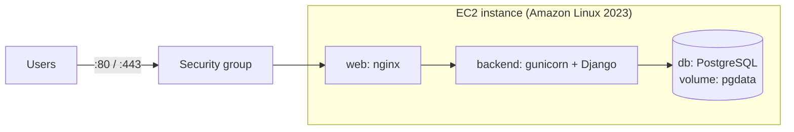
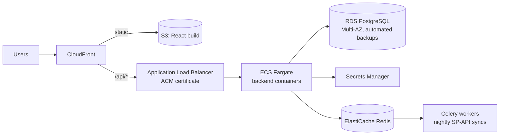

# Deployment

ShelfSense ships as three containers (PostgreSQL, Django/gunicorn and nginx) orchestrated by
Docker Compose. That makes the simplest production setup a **single AWS EC2 instance**, which fits
within the AWS Free Tier for new accounts.



## 1. Single EC2 instance with Docker Compose

### Launch the instance

1. EC2 → **Launch instance**
   - AMI: **Amazon Linux 2023**
   - Instance type: a Free Tier eligible type (e.g. `t3.micro` or `t2.micro`)
   - Key pair: create or select one for SSH
   - Network: allow **SSH (22)** from your IP, plus **HTTP (80)** and **HTTPS (443)** from anywhere
   - Storage: 20 GB gp3
2. Optional: allocate an **Elastic IP** and associate it, so the address survives reboots.

### Install Docker

```bash
ssh -i your-key.pem ec2-user@<public-ip>

sudo dnf update -y
sudo dnf install -y docker git
sudo systemctl enable --now docker
sudo usermod -aG docker ec2-user

# Docker Compose v2 plugin
sudo mkdir -p /usr/local/lib/docker/cli-plugins
sudo curl -SL https://github.com/docker/compose/releases/download/v2.29.7/docker-compose-linux-x86_64 \
  -o /usr/local/lib/docker/cli-plugins/docker-compose
sudo chmod +x /usr/local/lib/docker/cli-plugins/docker-compose

# 1 GB instances: add swap so the frontend build has enough memory
sudo dd if=/dev/zero of=/swapfile bs=1M count=2048 && sudo chmod 600 /swapfile
sudo mkswap /swapfile && sudo swapon /swapfile
echo '/swapfile swap swap defaults 0 0' | sudo tee -a /etc/fstab

exit   # log out and back in so the docker group applies
```

### Deploy

```bash
git clone https://github.com/S-Raha23/ShelfSense.git
cd ShelfSense
cp .env.example .env
```

Edit `.env`:

```ini
SECRET_KEY=<output of: python3 -c "import secrets; print(secrets.token_urlsafe(50))">
DEBUG=false
ALLOWED_HOSTS=<public-ip-or-domain>
POSTGRES_PASSWORD=<a strong password>
SEED_DEMO=true
```

```bash
docker compose up -d --build
docker compose ps                 # all services "running" / "healthy"
curl http://localhost/api/health/ # {"status": "ok"}
```

The app is now live at `http://<public-ip>`. On every start the backend container runs migrations
and, when `SEED_DEMO=true`, refreshes the demo account.

### Updating

```bash
git pull
docker compose up -d --build      # rebuilds changed images, re-runs migrations on start
docker image prune -f
```

### Operations

```bash
docker compose logs -f backend                         # application logs
docker compose exec backend python manage.py createsuperuser   # Django admin at /admin/
docker compose exec db pg_dump -U shelfsense shelfsense > backup.sql   # backup
```

## 2. HTTPS with a domain (optional)

Point an A record at the Elastic IP, then the easiest option is to put
[Caddy](https://caddyserver.com/) in front, which obtains and renews Let's Encrypt certificates
automatically:

1. Change the `web` service's port mapping to `"8080:80"`.
2. Run Caddy on the host: `caddy reverse-proxy --from your-domain.com --to localhost:8080`
3. In `.env` set `ALLOWED_HOSTS=your-domain.com`, `CSRF_TRUSTED_ORIGINS=https://your-domain.com`
   and `SECURE_COOKIES=true`.

Django already trusts `X-Forwarded-Proto` from the proxy (`SECURE_PROXY_SSL_HEADER`).

## 3. Production-grade AWS architecture (upgrade path)

The single-instance setup is simple and cheap, but the database and the app share one machine.
The codebase is ready to split out, because all configuration comes from environment variables:



| Concern | Change |
|---|---|
| Database | Amazon RDS for PostgreSQL. Set `DATABASE_URL` to the RDS endpoint. No code changes needed. |
| Frontend | `npm run build` and upload `dist/` to S3, served through CloudFront. Set `VITE_API_URL` if the API is on another domain, and add that domain to `CORS_ALLOWED_ORIGINS`. |
| Backend | Push the `backend/` image to ECR and run it on ECS Fargate behind an ALB using `/api/health/` health checks |
| Secrets | AWS Secrets Manager or SSM Parameter Store, injected as environment variables |
| Background jobs | Celery + Redis (ElastiCache), with Celery Beat for scheduled syncs |
| Observability | CloudWatch Logs (gunicorn logs to stdout already), alarms on 5xx rate and failed `SyncJob`s |

## Environment variables

| Variable | Default | Purpose |
|---|---|---|
| `SECRET_KEY` | dev key | Django signing key. **Must** be set in production. |
| `DEBUG` | `false` | Never `true` in production |
| `ALLOWED_HOSTS` | `localhost,127.0.0.1` | Hostnames the site answers on |
| `DATABASE_URL` | built from `POSTGRES_*` | PostgreSQL connection URL |
| `CSRF_TRUSTED_ORIGINS` | – | e.g. `https://your-domain.com` |
| `CORS_ALLOWED_ORIGINS` | – | Only if the SPA is served from another origin |
| `SECURE_COOKIES` | `false` | `true` once served over HTTPS |
| `MARKETPLACE_CLIENT` | `mock` | `mock` or `sp_api` |
| `MOCK_FAILURE_RATE` | `0` | Fraction of mock API calls that fail with a simulated 429 |
| `SYNC_THROTTLE_RATE` | `20/hour` | Per-user sync rate limit |
| `SEED_DEMO` | `true` (compose) | Create or refresh the demo account on start |
| `SP_API_*` | – | Amazon SP-API credentials (refresh token, client ID and secret, marketplace ID) |
| `HTTP_PORT` | `80` | Host port for the web container |
