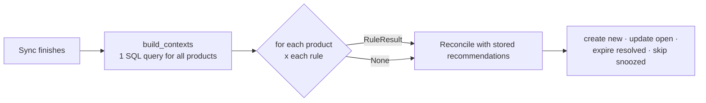

# Recommendation engine

The engine turns raw sales data into a short, ranked list of actions. Each recommendation answers
three questions: **what to do**, **how urgent it is** (severity) and **what it's worth**
(estimated monthly revenue at stake), and shows the **evidence** that triggered it.

## How it runs



1. **Build contexts.** For each active product, one aggregate query computes units (7 and 30 days),
   sessions and revenue (30 days), and the rating 30 days ago. Together with current price,
   competitor price and inventory, these fill an immutable `ProductContext`.
2. **Evaluate rules.** Each registered rule's `evaluate(ctx)` returns a `RuleResult` or `None`.
   Rules are pure functions with no database access.
3. **Reconcile with what's stored:**

| Situation | Result |
|---|---|
| Rule fires, nothing open | New recommendation, status `open` |
| Rule fires, already open | Numbers and text updated in place (no duplicates) |
| Was open, rule no longer fires | Status `expired` (the problem went away on its own) |
| User marked it `done` or `dismissed` in the last 14 days | Skipped, so the user's decision is respected |

A partial unique index (`UNIQUE(product, rule_code) WHERE status='open'`) enforces the
"one open per product and rule" invariant in the database itself.

## Shared inputs

| Input | Definition |
|---|---|
| Sales velocity | `units_7d / 7`. The last 7 days react faster than a 30-day average. |
| Days of cover | `inventory_qty / velocity` (infinite when there are no recent sales) |
| Conversion rate | `units_30d / sessions_30d`, Amazon's "unit session percentage" |

## The rules

### 1. Low stock (`low_stock`, inventory)

Running out of stock loses sales *and* hurts organic ranking, which takes weeks to recover.

| | |
|---|---|
| Fires when | days of cover < **21** (replenishment lead time) |
| Severity | High < 7 days · Medium < 14 · Low otherwise |
| Action | Reorder `velocity × (21 + 30) − inventory` units, covering the lead time plus 30 days |
| Impact | `(21 − cover) × velocity × price`: the revenue lost during the stockout gap |

### 2. Overstock (`overstock`, inventory)

| | |
|---|---|
| Fires when | days of cover > **120**, or stock with no recent sales |
| Severity | Medium > 180 days · Low otherwise |
| Action | Coupon or Lightning Deal, or pause replenishment |
| Impact | `excess_units × $0.75` monthly storage fees, where excess is stock beyond 60 days of cover |

### 3. Price gap (`price_gap`, pricing)

On Amazon, an offer priced well above comparable ones loses Buy Box share and conversion.

| | |
|---|---|
| Fires when | price is more than **10%** above the competing offer (up to 10% is treated as brand premium) |
| Severity | High > 25% · Medium > 15% · Low otherwise |
| Action | Reprice to competitor + 3% |
| Impact | Projected revenue change, assuming price elasticity of **2.0**: `new_price × units × (1 + 2 × drop%) − price × units` |

### 4. Rating drop (`rating_drop`, listing)

| | |
|---|---|
| Fires when | rating fell ≥ **0.2★** in 30 days, or is below **4.0★** |
| Severity | High if below 3.8★ or a drop ≥ 0.4★ · Medium otherwise |
| Action | Check recent 1–2★ reviews for a recurring defect, fix it, and use *Request a Review* |
| Impact | `revenue_30d × 25% per star × stars at risk` |

### 5. Low conversion (`low_conversion`, listing)

Plenty of traffic but few purchases usually means the listing itself is the problem.

| | |
|---|---|
| Fires when | ≥ **300** sessions in 30 days and conversion < **6%** |
| Severity | High < 3% · Medium < 4.5% · Low otherwise |
| Action | Refresh the main image, tighten the title and bullets, add A+ content |
| Impact | Recovering half the gap to a **10%** benchmark: `(0.10 − rate) × 0.5 × sessions × price` |

> **About the estimates.** The impact formulas are deliberately simple, transparent heuristics,
> meant for *ranking* recommendations against each other rather than as forecasts. The
> constants are class attributes, so they can be tuned (or learned) without touching the logic.

## Adding a rule

Example: flag best-sellers with few reviews. This rule needs one new input, `review_count`, so the
steps are (1) add `review_count: int` to `ProductContext`, (2) pass `review_count=p.review_count`
in `engine.build_contexts()`, and (3) write the rule:

```python
# backend/apps/recommendations/rules/listing.py
@register
class FewReviewsRule(Rule):
    code = "few_reviews"
    category = Recommendation.Category.LISTING
    MIN_REVIEWS = 50

    def evaluate(self, ctx: ProductContext):
        if ctx.units_30d < 100 or ctx.review_count >= self.MIN_REVIEWS:
            return None
        return RuleResult(
            severity=Recommendation.Severity.LOW,
            title=f"Build social proof for {ctx.title}",
            message="Selling well but has few reviews. Enrol in Amazon Vine.",
            estimated_impact=money(float(ctx.revenue_30d) * 0.05),
            evidence={"review_count": ctx.review_count},
        )
```

The engine itself doesn't change: `@register` adds the rule to the registry, and it runs on the next
sync. Write unit tests by building a `ProductContext` directly (see
`tests/test_rules.py`), with no database required.
